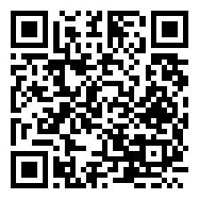
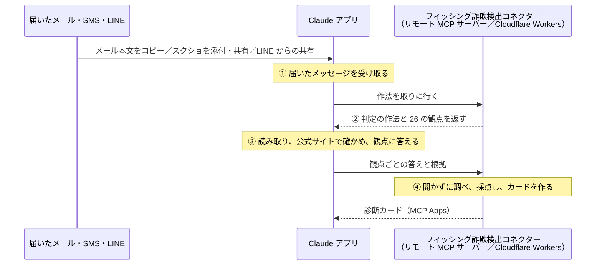

# フィッシング詐欺検出コネクター

届いたメール・SMS・LINE を **Claude アプリに見せるだけ** で、フィッシング詐欺かどうかを診断する、Claude 用のコネクター（リモート MCP サーバー）です。

- 本文をコピーして貼る、スクリーンショットを送る、LINE から共有する、のどれでも診断できます。
- **Claude アプリは判定しません。** Claude アプリは画面や本文を読み、決められた観点に根拠付きで答えるだけです。点数と判定、カードの文面はコネクターが決めます。
- 詐欺サイトは開きません。短縮 URL の行き先や、ドメインの登録日は、ページを開かずに調べます。

デモ動画（2 分 59 秒）：https://youtu.be/nMDkhEJZ0EI

## なぜ作ったか

偽の通販サイトを判定する [詐欺ダメ.com](https://sagidame.com/) を Claude Code で開発し、2026 年 6 月から運営しています（ハッカソン以前のサービスです）。これまでに 9 万件以上の詐欺サイトを検知してきました。偽警察やサポート詐欺のサイトを警告するブラウザ拡張機能、検知したサイトの公開、公的機関への通報も行ってきました。

運営する中で見えていたのは、こうした対策がどれも **PC のブラウザ向け**だということです。一方で、フィッシング詐欺の最前線はスマホです。メール、SMS、LINE と詐欺につながる入口が多く、アプリごとに対策を作ることはできず、手を付けられずにいました。

そこで、スマホの利用者がふだんでも使える **Claude アプリに入口を集約する** ことにしました。届いたものを見せるだけで診断できれば、入口がいくつあっても守れます。

当初は Safari の拡張機能として開発する予定でしたが、Claude アプリに入口を集約したことで、スマホの機種に依存しなくなりました。

## 試し方（審査員の方へ）

1. **ブラウザ**で [claude.ai](https://claude.ai) にログインし、**設定 → コネクタ → カスタムコネクタを追加** を選びます。スマホでも、Claude アプリではなく Safari や Chrome から開いてください（アプリの中からはコネクタを追加できません）。
2. 名前は自由です（例：`詐欺検出コネクター`）。URL に次を入れて追加します。

   ```
   https://bwc-probe.taka-bwc-japan-2026.workers.dev/mcp
   ```

   スマホで追加するときは、この QR コードを読み取って URL をコピーし、ブラウザの claude.ai に貼り付けてください。

   

3. 新しい会話で、コネクターがオンになっていることを確かめます。一度ブラウザで追加すれば、PC に加え、iPhone / Android の Claude アプリでも、同じアカウントならそのまま使えます。
4. 設定の **機能 → ツールアクセス** を **「いつでも利用可能」** にしておくことをおすすめします。初期値の「オート」では、依頼の文なしで共有したときに、コネクターが使われないことがあります（[いまの課題](#いまの課題とこれから)）。
5. 怪しいメールの本文を貼るか、画面のスクリーンショットを送ります。依頼の文は要りません。
6. 初回は、コネクターの道具を使ってよいかの確認が出ます。「常に許可」にすると、次からは出ません。

結果は会話の中に **診断カード** として出ます。カードには、点数と判断、決め手になった行と原文、対処方法、追加で確かめたいことが表示されます。

> 撮影では、無料プランのアカウントでカスタムコネクタを追加して使いました（2026 年 11 月時点）。

### 試しやすい例

`connector/tests/cases.json` に、診断を確かめるための文面が 27 件あります。実在の組織名や、架空の差出人で作った文面です。

- 社長を名乗り、LINE グループの作成と QR コードの送付を求めるメール
- 警察を名乗り、「安全な口座」への振り替えを求めるメール
- 銀行を名乗り、確認手続きのボタンへ誘導するメール（差出人のアドレスを聞かれたら答えると、もう一度診断します）
- 家族から届いた、本物の通販サイトの短縮 URL

## 仕組み



| 手順 | どこで | すること |
|---|---|---|
| ① | Claude アプリ | 届いたメッセージを受け取る |
| ② | コネクター | 判定の作法と 26 の観点を返す |
| ③ | Claude アプリ | 読み取り、公式サイトで確かめ、観点に答える |
| ④ | コネクター | 開かずに調べ、採点し、カードを作る |

コネクターには道具が 2 つあります。

| 道具 | 役割 |
|---|---|
| `get_judgment_protocol` | 判定の作法（観察の決まり、26 の観点、質問の候補）を Claude に渡す |
| `score_observations` | Claude が答えた観点と根拠を受け取り、URL を調べて採点し、診断カードを返す |

### 設計で決めていること

- **判定はコネクターだけが行う。** Claude は観点に「はい・いいえ」と、画面や本文の原文で答えます。同じ答えなら、いつも同じ点数と判定になります。
- **配点は公開しない。** 配点が読めると、点数を避ける偽のページを作れてしまうためです。公開中のコネクターは Cloudflare の Secret の配点を使います。リポジトリの値は見本です（[connector/docs/scoring-config.md](connector/docs/scoring-config.md)）。
- **根拠は組織自身の公式サイトだけ。** 差出人やログイン先の照合には、名乗る組織が自分のサイトに書いているドメインだけを使います。まとめ記事や他社の注意喚起は使いません。
- **決め手がなければ点数を止める。** 誘導や期限などの、正規の連絡にもある観点だけでは「疑い大」にしません。差出人など、確かめたいことを 1 つだけ聞き、答えを足してもう一度診断します。
- **詐欺サイトは開かない。** 短縮 URL は、短縮サービスに行き先だけを問い合わせます。ドメインの登録日は、まず利用者の端末から RDAP（登録情報の公開窓口）に問い合わせ、取れなければコネクターから問い合わせます。どちらも、相手のサイトには接続しません。
- **根拠の本文は記録しない。** ログに残すのは、点数・判定・当てはまった観点の名前だけです。

## Claude の使い方

**役割を分けた。** Claude に「詐欺かどうか」を決めさせると、言い回しや文面の印象で答えが揺れます。そこで、Claude には得意なことだけを任せ、決めることはコネクターに寄せました。

| | Claude アプリ | コネクター |
|---|---|---|
| すること | 画面や本文を読み取る／名乗る組織の公式サイトを検索して確かめる／26 の観点に原文の根拠付きで答える／足りない情報を 1 つ選ぶ | 判定の作法と観点を渡す／URL を開かずに調べる／採点・判定・カードの文面を決める |
| しないこと | 点数、判定、カードの文面を決める | 画面を読む、Web を検索する |

**MCP の機能を目的に合わせて使った。**
- 道具（Tools）：作法を渡す `get_judgment_protocol` と、採点する `score_observations` の 2 つ。作法を道具で渡すので、観点を足したり直したりしても、利用者の Claude アプリの設定は変わりません。
  - 作法は Skills にもできますが、あえて道具で渡しています。Skills は利用者が自分で入れる写しになり、新しい手口の観点を足しても全員には届かないためです。道具で渡せば、コネクターを直すだけで全員に反映されます。
- MCP Apps：診断結果を、会話の中の **診断カード** として出します。カードは利用者の端末からドメインの登録日を調べ、取れたら採点し直します。Claude の返答は「診断カードをご確認ください。」の 1 文だけにして、カードと違うことを言わないようにしています。

**Claude Code を開発の中心にした。** 作法の文、採点の決まり、カードの文面は、すべて Claude Code と一緒に書きました。作法を直すたびに、次の道具で確かめています。

- `tests/run-one.mjs`：Claude Code（`claude -p`）から公開中のコネクターを呼び、文面 1 件を実際に診断させる。スクリーンショットや、質問への答えを足した再診断も試せる。
- `tests/run-protocol.mjs`：27 件の文面を何度も流し、判定と回答の形がそろうかを一覧にする。
- `tests/score-direct.mjs`：Claude を介さずに採点の道具を直接呼び、配点と判定の決まりを確かめる。

iPhone の実機で起きたこと（差出人のアドレスを答えても点数が上がらない、観点の入れ忘れでエラーになる、など）も、これらの道具で再現して作法とコードを直し、実機で確かめ直しています。

動画の編集と、コネクターの実装・検証は、Claude Code のセッションを分けて同時に進めました。実機で見つかった問題は、検証用のセッションに渡して再現と修正を任せ、直った版で動画を撮り直しています。

## 対象としているもの・していないもの

- 対象：メール・SMS・LINE などで届く、フィッシング詐欺のメッセージ
- 対象外：偽の通販サイトの判定。これは、ハッカソン以前から運営している [詐欺ダメ.com](https://sagidame.com/) で判定しています（このリポジトリには含まれません）。

## いまの課題とこれから

- **コネクターが使われないことがある**：依頼の文を付けずに共有すると、Claude がコネクターを使わずに答えることがあります。claude.ai がカスタムコネクターのツールを、最初は名前だけしか Claude に見せないためで、Anthropic 公式の課題管理にも同じ報告があります（[anthropics/claude-ai-mcp#1105](https://github.com/anthropics/claude-ai-mcp/issues/1105)）。ツールアクセスを「いつでも利用可能」にすると、手元の iPhone では 5 回とも使われましたが、確実ではありません。
- **新しい手口への対応**：手口は変わり続けるので、新しい手口に合わせて観点とテストを足していきます。観点はコネクターが渡すので、利用者の Claude アプリには何も足さずに広がります。
- **詐欺ダメ.com との連携**：9 万件以上の偽サイトのデータとつなぎ、偽通販サイトの判定にも広げる予定です（まだつないでいません）。
- **読み取りの揺れ**：同じメッセージでも、Claude の読み取りが揺れて点数が数点変わることがあります。テストの例を増やして減らしていきます。

## 開発

ハッカソン期間中（2026 年 11 月 2 日から）に、Claude Code と一緒に開発しました。判定の作法は、実際の文面で試しながら v0.1 から v0.43 まで改訂を重ねています。

```
connector/
  src/index.ts      MCP サーバーと 2 つの道具
  src/protocol.ts   判定の作法（Claude に渡す文）
  src/scoring.ts    観点・採点・カードの文面
  src/app.ts        診断カード（MCP Apps、端末から RDAP に問い合わせ）
  src/shorturl.ts   短縮 URL の行き先の取得（行き先は開かない）
  src/domain.ts     ドメインの調べ（似せ文字、サブドメイン、登録日）
  src/urlkind.ts    共有された URL の種類の見分け
  src/freemail.ts   誰でも作れるメールアドレスかの判定
  tests/            文面ごとの期待する判定と、確かめるための道具
video/              デモ動画の作り方（Remotion、ナレーション、BGM）
```

手元で動かす：

```bash
cd connector
npm install
npm run dev      # http://localhost:8788/mcp
npm run check    # 型の確認
```

確かめる（公開中のコネクターに、Claude Code から 1 件流す）：

```bash
node connector/tests/run-one.mjs --text "メールの本文"
```

## デモ動画について

- 映像は [Remotion](https://www.remotion.dev/) と FFmpeg で作りました。デモの場面は、iPhone の画面を実際に録画したものです。
- 撮影用のメールは、PC の中の試験用メールボックス（Docker）に入れたもので、外部には送っていません。実在の偽サイトのドメインや、個人の情報は映していません。
- BGM と効果音は、コードから生成しました（`video/audio/gen.mjs`）。
- ナレーション：AivisSpeech（阿井田 茂 / CV：古山キリヲ、Aivis Common Model License 1.0）

## ライセンス

Copyright (c) 2026 ConoHa0708. All rights reserved.

このリポジトリのコードと文書の著作権は作者が持ち、オープンソースのライセンスは付けていません。審査のための閲覧と、公開中のコネクターを試すことはご自由にどうぞ。それ以外の利用（コードの複製・改変・再配布、作法の文や観点の流用など）は、事前にご相談ください。

詐欺ダメ.com は、このリポジトリに含まれない別のサービスです。
